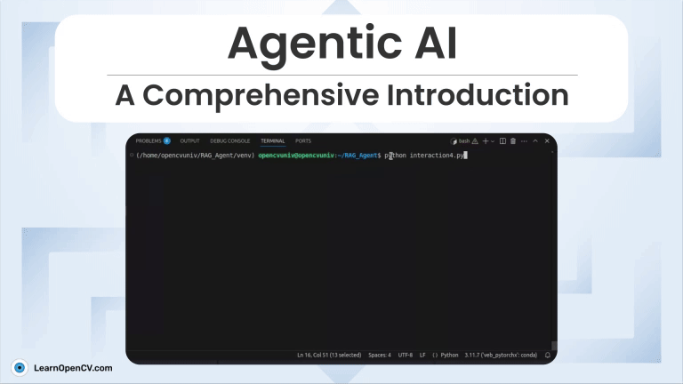
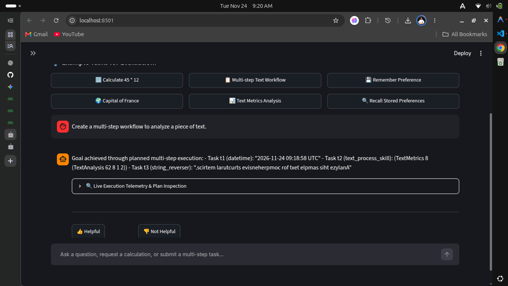
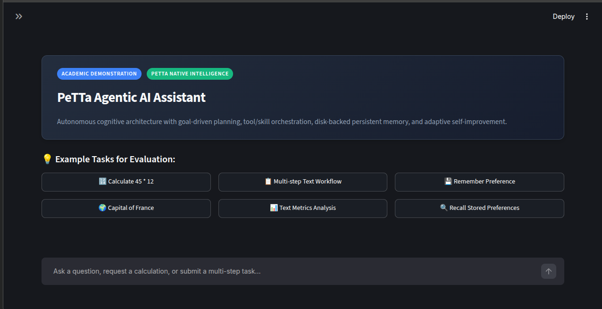
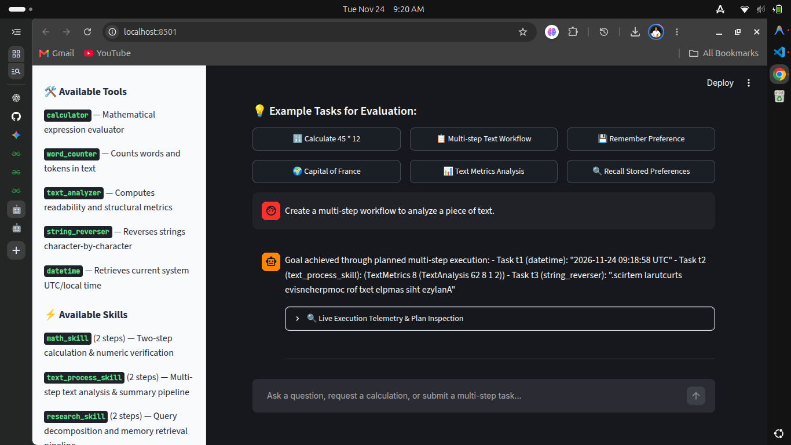

# PeTTa Agentic AI Framework

[](LICENSE)
[-orange.svg)](https://github.com/trueagi-io/PeTTa)
[](https://streamlit.io)
[-brightgreen.svg)](docs/TESTING_AND_VERIFICATION.md)
[](https://github.com/Tesfalegnp/Agentic-AI-With-PeTTa)

<div align="center">
  
</div>

> **A robust, modular, and extensible Agentic AI framework combining the formal symbolic reasoning, pattern-matching, and knowledge representation of PeTTa (Prolog-enhanced MeTTa) with neural Large Language Model orchestration.**

---

## 1. Project Overview

The **PeTTa Agentic AI Framework** is an autonomous cognitive architecture where **PeTTa owns all agent cognition, orchestration, decision execution, and memory**, while Python serves strictly as a lightweight transport bridge for external Large Language Models (LLMs) and presentation.

Unlike conventional agent frameworks (such as LangChain, CrewAI, or AutoGen) where control logic, memory management, and prompt engineering are implemented imperatively in Python, this framework implements all agent intelligence symbolically within **PeTTa AtomSpaces**, utilizing SWI-Prolog's formal logic engine for deterministic validation, dependency scheduling, and knowledge persistence.

---

## 2. Project Objectives & Motivation

1. **Symbolic–Neural Unification:** Pair the linguistic fluency and broad reasoning of LLMs with the formal verification, determinism, and explainability of symbolic knowledge engines.
2. **Purity of Agent Runtime:** Demonstrate a true non-Python agent core where cognitive loops, action validation, and task planning reside natively in PeTTa.
3. **Deterministic Safety:** Eliminate hallucinations and malformed function calls through a formal S-expression action protocol validated before execution.
4. **Long-Term Memory & Provenance:** Provide durable, disk-backed memory with semantic ranking, access tracking, and contradiction detection.
5. **Goal-Driven Task Decomposition:** Enable autonomous multi-step planning with directed acyclic graph (DAG) dependency scheduling and failure recovery.
6. **Continuous Self-Improvement:** Incorporate an adaptive learning loop where explicit user feedback synthesizes behavioral rules stored directly in the AtomSpace.

---

## 3. Key Features & Capabilities

- **Strict Separation of Concerns:** PeTTa handles all agent intelligence; Python is restricted to stateless API transport and presentation.
- **Canonical Eight-Action Protocol:** Exact grammar for `answer`, `use_tool`, `use_skill`, `remember`, `recall`, `ask_user`, `finish`, and `error`.
- **Multi-Provider LLM Integration:** Out-of-the-box support for Google Gemini, OpenAI, DeepSeek, and generic OpenAI-compatible local models (Ollama, vLLM).
- **Native Tool Engine:** Built-in arithmetic, string analysis, and timestamp tools executed directly within Prolog/PeTTa.
- **Composite Skill Workflows:** Multi-step workflows coordinating multiple tools, intermediate data transformations, and metric aggregation.
- **Persistent Memory Subsystem:** Five memory categories (`preference`, `fact`, `goal`, `project`, `episodic`), disk serialization, recency/frequency ranking, and contradiction detection.
- **Goal-Driven DAG Planning:** Autonomous request decomposition into directed acyclic task graphs with cycle detection, topological sorting, and error recovery.
- **Adaptive Learning:** Explicit user feedback tracking leading to automated synthesis of `AdaptationRule` atoms that dynamically adjust future prompts.
- **Interactive Web Interface:** Modern Streamlit UI featuring live unbuffered progress streaming, visual task DAG cards, AtomSpace inspection, and evaluator demonstration modes.

---

## 4. Architecture Overview

The system operates across three decoupled layers:
1. **PeTTa Symbolic Core:** Manages the cognitive reasoning loop, working memory (`&conversation`), goal planning (`&goal_space`), persistent memory (`&long_term`), and feedback adaptations (`&adaptation_space`).
2. **Python Bridge Layer:** Invoked via SWI-Prolog Janus `py-call` to provide stateless HTTP REST communication with external LLM endpoints.
3. **Streamlit UI Layer:** Subprocess-isolated presentation client that tails unbuffered JSONL telemetry files to render live execution progress.

---

## 5. Architecture Diagram

```mermaid
flowchart TD
    subgraph Presentation_Layer ["Presentation Layer (Python / Streamlit)"]
        User(["User / Academic Evaluator"])
        WebUI["Streamlit Web UI (ui/app.py)"]
        CLI["Terminal Interface (main.metta)"]
        ClientAdapter["Client Adapter (ui/agent_client.py)"]
    end

    subgraph IPC_Transport ["Safe File-Based Telemetry & IPC (memory/)"]
        QueryFile["session_query.txt"]
        EventsFile["session_events.jsonl (Unbuffered JSONL)"]
        ResultFile["session_result.json"]
        FeedbackFile["session_feedback.json"]
    end

    subgraph PeTTa_Core ["PeTTa Agentic Core (SWI-Prolog + MeTTa)"]
        UIGateway["ui_gateway.metta"]
        FeedbackGateway["feedback_gateway.metta"]
        TelemetryModule["telemetry.metta & telemetry_io.pl"]
        CognitiveLoop["loop.metta (Cognitive Cycle)"]
        ActionValidator["action_validator.metta (8 Actions)"]
        PromptEngine["prompt.metta & context_manager.metta"]
        GoalPlanner["goal_planner.metta & plan_executor.metta"]
        ToolEngine["tool_registry.metta & tool_dispatcher.metta"]
        SkillEngine["skill_registry.metta & skill_executor.metta"]
        MemoryCore["memory_core.metta & memory_store.metta"]
        AdaptationEngine["adaptation_engine.metta & feedback_store.metta"]
    end

    subgraph AtomSpaces ["PeTTa AtomSpaces (Symbolic Knowledge State)"]
        ConvSpace["&conversation (Working Memory)"]
        LongTermSpace["&long_term (Persistent Memory)"]
        GoalSpace["&goal_space (Active Goals)"]
        PlanSpace["&plan_space (Task DAGs)"]
        FeedbackSpace["&feedback_space (User Feedback)"]
        AdaptationSpace["&adaptation_space (Learned Rules)"]
    end

    subgraph Python_Bridge ["External LLM Bridge (Python / Janus)"]
        Bridge["bridge.py (Unified Query Router)"]
        GeminiProvider["providers/gemini.py"]
        OpenAIProvider["providers/openai.py"]
        DeepSeekProvider["providers/deepseek.py"]
    end

    User <-->|Browser| WebUI
    User <-->|Terminal| CLI
    CLI --> CognitiveLoop
    WebUI <--> ClientAdapter
    ClientAdapter -->|Safe Query Write| QueryFile
    ClientAdapter -->|Spawn Subprocess| UIGateway
    ClientAdapter -->|Feedback Write| FeedbackFile
    ClientAdapter -->|Spawn Subprocess| FeedbackGateway
    UIGateway -->|Read Query| TelemetryModule
    TelemetryModule <--> QueryFile
    FeedbackGateway -->|Read Feedback| TelemetryModule
    TelemetryModule <--> FeedbackFile

    UIGateway --> CognitiveLoop
    FeedbackGateway --> AdaptationEngine
    CognitiveLoop <--> PromptEngine
    CognitiveLoop <--> ActionValidator
    CognitiveLoop <--> GoalPlanner
    CognitiveLoop <--> ToolEngine
    CognitiveLoop <--> SkillEngine
    CognitiveLoop <--> MemoryCore
    CognitiveLoop <--> TelemetryModule
    TelemetryModule -->|Unbuffered Stream| EventsFile
    ClientAdapter -->|Real-time Tailing| EventsFile

    CognitiveLoop <--> ConvSpace
    MemoryCore <--> LongTermSpace
    GoalPlanner <--> GoalSpace
    GoalPlanner <--> PlanSpace
    AdaptationEngine <--> FeedbackSpace
    AdaptationEngine <--> AdaptationSpace

    CognitiveLoop <-->|Janus py-call| Bridge
    Bridge <--> GeminiProvider
    Bridge <--> OpenAIProvider
    Bridge <--> DeepSeekProvider
```



---

## 6. Why PeTTa is the Agent Runtime

Traditional agentic frameworks suffer from three fundamental limitations:
1. **Non-deterministic state transitions:** Complex procedural code in Python makes it difficult to formally track or constrain agent behavior.
2. **Fragile JSON Schema parsing:** LLMs frequently produce malformed JSON that breaks Python parsers during nested function calling.
3. **Ephemeral working memory:** Most frameworks store memory as unstructured text lists in Python dictionaries, lacking native pattern matching, unification, or formal graph representation.

**PeTTa solves these challenges:**
- **AtomSpace as Knowledge Graph:** Memories, goals, plan DAGs, tools, and feedback are represented as first-class symbolic atoms.
- **Formal Pattern Matching:** Retrieval, ranking, and conflict detection use native unification (`match`) and backward-chaining Prolog logic.
- **Bounded Recursive Execution:** The cognitive cycle is a formal recursive reduction bounded by explicit maximum iterations, preventing runaway loops.

---

## 7. Exact Responsibility Boundary: PeTTa vs. Python

| Responsibility | PeTTa / Prolog | Python Layer |
| :--- | :---: | :---: |
| **Cognitive Loop & Execution Cycle** | **OWNER** | *Excluded* |
| **Action Parsing & Grammar Validation** | **OWNER** | *Excluded* |
| **Tool & Skill Registries & Invocation** | **OWNER** | *Excluded* |
| **Goal Planning & DAG Scheduling** | **OWNER** | *Excluded* |
| **Task Dependency Resolution & Recovery** | **OWNER** | *Excluded* |
| **Persistent Memory (CRUD, Ranking, Disk)**| **OWNER** | *Excluded* |
| **User Feedback & Adaptation Synthesis** | **OWNER** | *Excluded* |
| **External LLM REST Transport** | *Excluded* | **OWNER** |
| **API Authentication & Model Selection** | *Excluded* | **OWNER** |
| **Streamlit Web Presentation** | *Excluded* | **OWNER** |
| **Non-blocking JSONL File Tailing** | *Excluded* | **OWNER** |

---

## 8. Canonical Eight-Action Protocol

Every LLM decision must parse into exactly one of eight canonical S-expression actions:

| Action Syntax | Description | Example |
| :--- | :--- | :--- |
| `(action answer "<content>")` | Direct factual or conversational answer. | `(action answer "Paris is the capital of France.")` |
| `(action use_tool <name> (<args...>))` | Invokes single registered tool. | `(action use_tool calculator ("45 * 12"))` |
| `(action use_skill <name> (<args...>))` | Invokes composite multi-step workflow. | `(action use_skill text_analysis_skill ("Sample text..."))` |
| `(action remember <cat> "<content>")` | Stores fact/preference into `&long_term`.| `(action remember preference "User prefers concise answers.")` |
| `(action recall <cat> "<query>")` | Searches memories in `&long_term`. | `(action recall preference "answer formatting")` |
| `(action ask_user "<question>")` | Requests user clarification or resolves conflicts. | `(action ask_user "Which calculation would you like?")` |
| `(action finish "<summary>")` | Concludes multi-step plan after verification. | `(action finish "Task workflow completed successfully.")` |
| `(action error "<diagnostic>")` | Terminates on invalid input or policy block.| `(action error "Calculation argument was non-numeric.")` |

Detailed protocol specifications and negative validation examples are documented in [docs/AGENT_PROTOCOL.md](docs/AGENT_PROTOCOL.md).

---

## 9. Tool and Skill Architecture

### Built-in Deterministic Tools (`agent/tool_registry.metta`, `tools/`)
- `calculator`: Deterministic arithmetic expression evaluation via Prolog `is/2`.
- `word_counter`: UTF-8 word token count analysis.
- `char_counter`: Character length calculation.
- `echo`: Identity parameter transformation.
- `get_timestamp`: Current Unix epoch timestamp.

### Composite Skills (`agent/skill_registry.metta`, `skills/`)
- `math_skill`: Multi-step arithmetic with rounding and formal validation.
- `text_analysis_skill`: Coordinates word counting, character length profiling, and readability classification.
- `report_skill`: Aggregates multi-metric analyses into a structured formatted text report.

---

## 10. Memory Architecture & AtomSpace Organization

The memory subsystem is organized into dedicated AtomSpaces:
- **`&conversation` (Working Memory):** Ephemeral session history storing `(UserMessage ...)`, `(AssistantMessage ...)`, and `(Observation ...)`.
- **`&long_term` (Persistent Storage):** Durable memories categorized as `preference`, `fact`, `goal`, `project`, or `episodic`. Automatically loaded on startup and serialized to disk on shutdown.
- **`&episodic` (Episode Log):** Structured history of multi-turn interactions.
- **`&feedback_space`:** Explicit evaluator feedback records.
- **`&adaptation_space`:** Active learned behavioral rules.

---

## 11. Memory-Aware Reasoning & Context Budgeting

Before querying the LLM, `agent/prompt.metta` and `agent/context_manager.metta` assemble a dynamic prompt:
1. **Semantic Ranking:** Memories in `&long_term` are ranked by relevance, recency, and frequency.
2. **Contradiction Detection:** Semantic pair matching identifies conflicting stored preferences (e.g., concise vs. detailed) and injects critical warnings directing the agent to invoke `(action ask_user ...)`.
3. **Context Budgeting:** Enforces a configurable 16,000 UTF-8 character limit (~4,000 tokens), preserving mandatory identity and protocol sections while trimming dynamic context if budget is exceeded.

---

## 12. Goal-Driven Planning & DAG Execution

When complex multi-step requests are received (e.g., containing workflows, pipeline dependencies, or "and then"), the system engages `agent/goal_planner.metta`:
1. **Decomposition:** Planner generates a structured `(plan-proposal ...)` containing tasks with explicit dependencies.
2. **Validation:** PeTTa verifies task count limits (<= 8), registered tool names, and acyclicity (no cyclic dependencies).
3. **Scheduling:** Computes topological execution order using Prolog graph algorithms.
4. **Execution:** Resolves inter-task bindings (`$T1.output`) and executes tasks in sequence.
5. **Verification & Recovery:** Inspects task outcomes; executes alternate recovery steps if tasks fail.

<div align="center">
  
  <p><em>Figure: Real-time Multi-Step Task Decomposition & Visual Plan DAG Execution with live status transitions.</em></p>
</div>

---

## 13. Adaptive Learning & Feedback

The framework continuously learns from user feedback:
1. Users provide explicit 👍 or 👎 feedback through the web UI or CLI.
2. `agent/feedback_gateway.metta` records feedback into `&feedback_space`.
3. When recurring patterns emerge, `agent/adaptation_engine.metta` synthesizes an `AdaptationRule` stored in `&adaptation_space` and persisted to disk.
4. Active adaptations are dynamically injected into subsequent prompts without requiring code modifications.

---

## 14. Streamlit User Interface

The modern web interface (`ui/app.py`) provides:
- **Subsystem Metrics:** Live count of stored memories and active adaptations.
- **Registry Inspection:** Sidebar catalog of all registered tools and composite skills.
- **Real-Time Telemetry Feed:** Native `st.status` widget rendering genuine PeTTa events as they stream from Prolog with zero mock latency.
- **Visual Task Cards:** Dynamic cards displaying real-time task states (⏳ `PENDING` -> ⚡ `RUNNING` -> ✅ `COMPLETED` -> ❌ `FAILED`).
- **Interactive Feedback Controls:** Built-in 👍 / 👎 buttons routing feedback directly to the adaptation engine.
- **High-Contrast Architecture:** Dedicated CSS rules ([ui/styles.py](ui/styles.py)) ensuring crisp readability in both light and dark modes.

<div align="center">
  
  <p><em>Figure 1: PeTTa Agentic AI Web Interface — Interactive Chat, Telemetry Feed, and Evaluation Quick Prompts.</em></p>
</div>

<div align="center">
  
  <p><em>Figure 2: Evaluator Sidebar — Subsystem Status, Registered Tools & Skills, and Architecture Transparency.</em></p>
</div>

---

## 15. Supported LLM Providers

| Provider | Key in `.env` | Default Model | Transport | Notes |
| :--- | :--- | :--- | :--- | :--- |
| **Google Gemini** | `GEMINI_API_KEY` | `gemini-2.5-flash` | Pure REST | Recommended default; fast, generous quota. |
| **OpenAI** | `OPENAI_API_KEY` | `gpt-4o-mini` | Pure REST | Full compatibility with `gpt-4o` and `gpt-4o-mini`. |
| **DeepSeek** | `DEEPSEEK_API_KEY` | `deepseek-chat` | Pure REST | DeepSeek-V3 and DeepSeek-R1 support. |
| **Generic OpenAI** | `GENERIC_OPENAI_API_KEY`| `llama3.1` | Pure REST | Connects to Ollama, vLLM, or LocalAI endpoints. |

---

## 16. Prerequisites & Environment Requirements

- **Operating System:** Linux (Ubuntu 22.04 LTS / 24.04 LTS recommended)
- **SWI-Prolog:** 9.2.0 or newer (with `janus`, `json`, `pcre`)
- **PeTTa Runtime:** Upstream commit from [trueagi-io/PeTTa](https://github.com/trueagi-io/PeTTa), binary at `/home/hope/.local/bin/petta`
- **Python:** 3.10 to 3.14 (managed via `.venv`)

---

## 17. Installation & Setup Instructions

```bash
# 1. Clone repository
git clone https://github.com/Tesfalegnp/Agentic-AI-With-PeTTa.git
cd Agentic-AI-With-PeTTa

# 2. Create and activate virtual environment
python3 -m venv .venv
source .venv/bin/activate

# 3. Install Python dependencies
pip install --upgrade pip
pip install -r requirements.txt
```

---

## 18. Environment Configuration

Copy the configuration template:
```bash
cp .env.example .env
```

Edit `.env` to configure your active provider:
```bash
LLM_PROVIDER=gemini
GEMINI_API_KEY=your_gemini_api_key_here
GEMINI_MODEL=gemini-2.5-flash
```

---

## 19. How to Launch the Application

### Option A: Interactive Streamlit Web Interface (Recommended)
```bash
source .venv/bin/activate
streamlit run ui/app.py
```
Open **`http://localhost:8501`** in your browser.

### Option B: Terminal CLI Interface
```bash
petta main.metta
```

---

## 20. How to Run Automated Tests

### Python Unit & Integration Tests (35 Tests)
```bash
.venv/bin/python3 -m unittest discover tests/
```

### PeTTa Subsystem Regression Suite (54 Tests)
```bash
.venv/bin/python3 -c "
import subprocess, glob
for d in ['tests/protocol', 'tests/agent', 'tests/tools', 'tests/skills', 'tests/memory', 'tests/planning', 'tests/adaptation']:
    for f in sorted(glob.glob(f'{d}/*.metta')):
        res = subprocess.run(['/home/hope/.local/bin/petta', f], capture_output=True, text=True)
        assert res.returncode == 0, f'Failed: {f}'
print('All 54 PeTTa subsystem tests passed!')
"
```

### Live End-to-End UI Integration Tests
```bash
.venv/bin/python3 -m unittest -v tests/ui/test_ui_runtime_integration.py
```

---

## 21. Evaluator Demonstration Scenarios

The web interface features 5 one-click demonstration scenarios:
1. **Direct Factual Reasoning:** `"What is the capital of France?"` — demonstrates single-step loop and action validation.
2. **Single-Tool Dispatch:** `"Calculate 45 multiplied by 12."` — demonstrates tool dispatching and observation integration.
3. **Composite Skill Workflow:** `"Analyze this text: '...'"` — demonstrates text profiling, word counting, and metric aggregation.
4. **Goal Decomposition & DAG Scheduling:** `"Create a multi-step workflow to analyze the words in '...' and calculate the square of that count."` — demonstrates real-time Visual Task Cards (`PENDING` -> `RUNNING` -> `COMPLETED`).
5. **Adaptive Self-Improvement:** Submit 👎 feedback on an answer — demonstrates feedback recording in `&feedback_space` and dynamic rule synthesis.

Detailed evaluator walkthroughs are documented in [docs/EVALUATOR_GUIDE.md](docs/EVALUATOR_GUIDE.md).

---

## 22. Project Directory Structure

```
petta-agentic-ai/
├── agent/                  # Core PeTTa agentic engine
│   ├── action_validator.metta
│   ├── adaptation_engine.metta
│   ├── context_budget.metta
│   ├── context_manager.metta
│   ├── controller.metta    # Terminal CLI conversational loop
│   ├── feedback_gateway.metta
│   ├── goal_planner.metta  # Multi-step DAG goal planner
│   ├── loop.metta          # Core cognitive reasoning loop
│   ├── memory_core.metta   # Persistent AtomSpace memory
│   ├── plan_executor.metta # DAG task scheduler & executor
│   ├── prompt.metta        # Dynamic system prompt engine
│   ├── telemetry.metta     # MeTTa telemetry bindings
│   ├── telemetry_io.pl     # SWI-Prolog unbuffered JSONL telemetry & safe IPC
│   ├── tool_registry.metta # Tool engine & validation
│   └── ui_gateway.metta    # Headless turn entry point for Web UI
├── asset/                  # Architectural diagrams, animations, and UI screenshots
│   ├── Agentic-AI.gif
│   ├── hero_home_page.png
│   ├── sample_task_with_multiple_step.png
│   └── tools_sidebare_image.png
├── docs/                   # Complete professional documentation
│   ├── ARCHITECTURE.md     # Full system architecture & Mermaid diagrams
│   ├── AGENT_PROTOCOL.md   # Eight canonical actions & validation specification
│   ├── SETUP_AND_CONFIGURATION.md # Installation & configuration guide
│   ├── TESTING_AND_VERIFICATION.md # Test catalog & baseline report
│   ├── EVALUATOR_GUIDE.md  # Demonstration scenarios for academic evaluators
│   ├── STAGE_E_AUDIT.md    # Pre-release audit & component inventory
│   ├── STAGE_E_CLEANUP.md  # Record of obsolete prototype cleanup
│   ├── milestones/         # Historical milestone reports (Milestones 8–13)
│   └── reference/          # Reference documents
├── memory/                 # Runtime persistence directories (.gitkeep tracked)
│   ├── adaptation/
│   ├── episodic/
│   ├── index/
│   └── long_term/
├── python_bridge/          # Stateless LLM REST transport layer
│   ├── bridge.py           # Unified query router
│   ├── config.py           # Provider configuration & models
│   └── providers/          # Gemini, OpenAI, DeepSeek, Generic REST providers
├── tests/                  # Complete test suites (89 automated tests)
│   ├── protocol/
│   ├── agent/
│   ├── tools/
│   ├── skills/
│   ├── memory/
│   ├── planning/
│   ├── adaptation/
│   └── ui/
├── tools/                  # Deterministic tool Prolog worker predicates
├── skills/                 # Composite skill Prolog workflow predicates
├── ui/                     # Presentation layer (Streamlit)
│   ├── agent_client.py     # Safe IPC adapter client
│   ├── app.py              # Streamlit Web Application
│   ├── event_protocol.py   # Event normalization & Task extraction
│   └── styles.py           # High-contrast CSS design tokens
├── .env.example            # Configuration template
├── .gitignore              # Production security exclusion rules
├── LICENSE                 # MIT License
├── main.metta              # Terminal CLI entry point
├── requirements.txt        # Python dependencies
└── README.md               # Root documentation guide
```

---

## 23. Security & Safety Considerations

- **No Code Injection:** User inputs are transported via UTF-8 text files and read via Prolog's `read_file_to_string/3`. Raw shell concatenation is forbidden.
- **No Unrestricted Evaluation:** Raw LLM outputs are never evaluated as executable PeTTa code. They must pass through formal S-expression parsing and action validation.
- **Secret Redaction:** Telemetry streams apply regex masking to sanitize API keys (`AIza...`, `sk-...`, `Bearer ...`) before display.
- **Deadlock Prevention:** PeTTa compiler output is redirected to `memory/gateway_stdout.log`, preventing Linux pipe buffer deadlocks.
- **Local Data Protection:** `.env` and session memory files are strictly excluded from version control.

---

## 24. Known Limitations & Future Work

- **Browser UI Threading:** Streamlit reruns on state updates; future iterations could leverage WebSockets for multi-client concurrent sessions.
- **External Tool Sandboxing:** Tools currently execute as safe local Prolog predicates; integration with external sandboxed containers (e.g., Docker or WASM) represents a logical extension for untrusted third-party tools.
- **Embedding-Based Semantic Retrieval:** Persistent memory currently uses keyword-frequency and recency scoring; integrating local vector embeddings inside Prolog will further enhance semantic retrieval.

---

## 25. Contribution & Development Guidance

1. Fork the repository on GitHub: [https://github.com/Tesfalegnp/Agentic-AI-With-PeTTa](https://github.com/Tesfalegnp/Agentic-AI-With-PeTTa).
2. Create a feature branch: `git checkout -b feature/new-capability`.
3. Follow the strict boundary rule: agent logic belongs in PeTTa (`agent/`), not Python.
4. Add automated tests in `tests/` and verify that all 89 tests pass:
   ```bash
   .venv/bin/python3 -m unittest discover tests/
   ```
5. Submit a descriptive Pull Request.

---

## 26. License

This project is licensed under the **MIT License** — see the [LICENSE](LICENSE) file for details.
