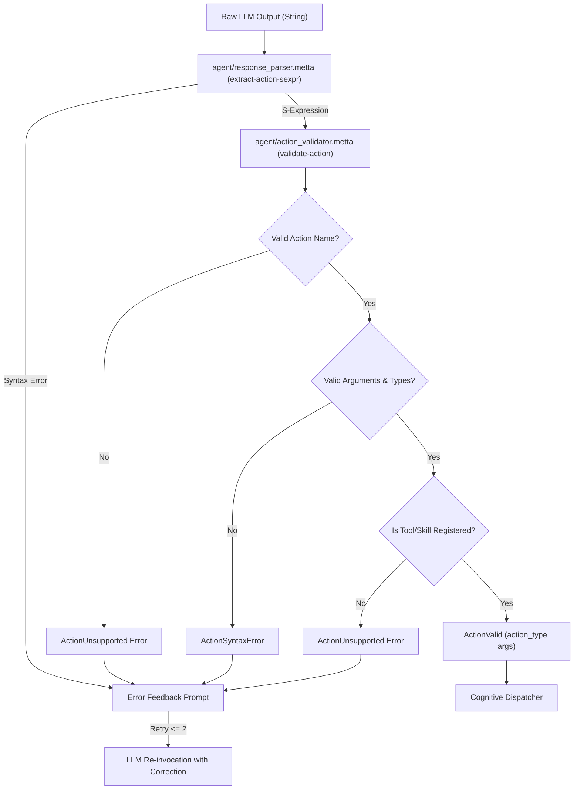

# PeTTa Agentic AI Framework: Canonical Action Protocol Specification

## 1. Protocol Overview

The **PeTTa Canonical Action Protocol** defines the strict, deterministic interface through which the agent communicates its decisions, invokes external capabilities, manipulates memory, and provides responses. 

Unlike conventional Python agent frameworks that rely on loose JSON Schema blobs or tool calling conventions, this framework represents all agent actions as formal **PeTTa S-expressions**.

Every response from the LLM reasoning step must parse into exactly **one** of the eight canonical actions:

```
(action <action_type> <arguments...>)
```

No ninth action is permitted. Any response deviating from this grammar is intercepted by `agent/action_validator.metta` and rejected with a typed validation error, prompting an automatic retry with corrective feedback.

---

## 2. Canonical Action Definitions

### 1. `answer` — Direct Conversational Response
- **Purpose:** Delivers a direct, reasoned, factual, or explanatory response to the user.
- **Syntax:** `(action answer "<content>")`
- **Arguments:**
  - `<content>` (String): The natural-language text response for the user.
- **Lifecycle:** Terminates the single-step cognitive cycle and persists the response to working memory `&conversation`.
- **Example:**
  ```lisp
  (action answer "The capital of France is Paris.")
  ```

---

### 2. `use_tool` — Deterministic Lower-Level Tool Invocation
- **Purpose:** Dispatches execution of a registered, single-purpose lower-level tool when computation, timestamp lookup, character counting, or text transformation is required.
- **Syntax:** `(action use_tool <tool_name> (<arg1> <arg2> ...))`
- **Arguments:**
  - `<tool_name>` (Symbol): The exact registered tool identifier (e.g., `calculator`, `word_counter`, `char_counter`, `echo`, `get_timestamp`).
  - `(<args...>)` (Expression List): Positional arguments conforming to the tool's registered signature.
- **Lifecycle:** Invokes the tool dispatcher, records execution in tool history, captures the deterministic observation, appends the observation to working memory, and triggers the next reasoning iteration.
- **Example:**
  ```lisp
  (action use_tool calculator ("45 * 12"))
  (action use_tool word_counter ("Symbolic AI and LLM integration"))
  ```

---

### 3. `use_skill` — Composite Multi-Step Workflow Invocation
- **Purpose:** Executes a higher-level composite workflow that coordinates multiple tools, transforms intermediate data, and computes aggregate metrics.
- **Syntax:** `(action use_skill <skill_name> (<arg1> <arg2> ...))`
- **Arguments:**
  - `<skill_name>` (Symbol): The exact registered skill identifier (e.g., `math_skill`, `text_analysis_skill`, `report_skill`).
  - `(<args...>)` (Expression List): Arguments conforming to the composite skill's workflow signature.
- **Lifecycle:** Executes the registered workflow rules, records execution in skill history, and returns a structured composite observation to the cognitive cycle.
- **Example:**
  ```lisp
  (action use_skill text_analysis_skill ("PeTTa enables native symbolic reasoning combined with neural language models."))
  (action use_skill math_skill ("125 * 8"))
  ```

---

### 4. `remember` — Durable Memory Storage
- **Purpose:** Stores persistent facts, user preferences, operational goals, or project metadata into disk-backed long-term memory.
- **Syntax:** `(action remember <category> "<content>")`
- **Arguments:**
  - `<category>` (Symbol): Must be one of `preference`, `fact`, `goal`, `project`, or `episodic`.
  - `<content>` (String): The text content to store.
- **Lifecycle:** Validates safety (rejects sensitive data like API keys/passwords), constructs a `MemoryRecord` with full provenance metadata (timestamp, source, priority, active status), persists to disk, and returns an observation.
- **Example:**
  ```lisp
  (action remember preference "User prefers concise, bulleted responses.")
  (action remember fact "Target programming language for the backend is Rust.")
  ```

---

### 5. `recall` — Semantic Memory Retrieval
- **Purpose:** Explicitly searches and retrieves stored memory records matching a query from the persistent memory AtomSpace.
- **Syntax:** `(action recall <category> "<query>")`
- **Arguments:**
  - `<category>` (Symbol): Target memory category or `all`.
  - `<query>` (String): Keywords or semantic search phrase.
- **Lifecycle:** Queries `&long_term`, ranks results by recency, access frequency, and relevance, and returns the top matching memories as an observation.
- **Example:**
  ```lisp
  (action recall preference "response formatting style")
  (action recall fact "database schema")
  ```

---

### 6. `ask_user` — Ambiguity Clarification & Contradiction Resolution
- **Purpose:** Suspends automated execution to request clarification from the user when inputs are ambiguous, parameters are missing, or conflicting memory preferences are detected.
- **Syntax:** `(action ask_user "<question>")`
- **Arguments:**
  - `<question>` (String): The targeted question clarifying the ambiguity.
- **Lifecycle:** Terminates the current cognitive turn with status `ask_user`, awaiting the user's clarifying response.
- **Example:**
  ```lisp
  (action ask_user "I noticed conflicting stored preferences for answer detail (concise vs. detailed). Which formatting style do you prefer for this report?")
  ```

---

### 7. `finish` — Multi-Step Task Completion
- **Purpose:** Concludes a multi-step workflow or planned task DAG after all goals and dependencies are verified as complete.
- **Syntax:** `(action finish "<summary>")`
- **Arguments:**
  - `<summary>` (String): A comprehensive summary of the completed task and its verified outcomes.
- **Lifecycle:** Marks the active goal as completed, logs execution metrics, and terminates the cycle.
- **Example:**
  ```lisp
  (action finish "The text analysis report and word count square calculations have been successfully completed.")
  ```

---

### 8. `error` — Diagnostic Policy or Execution Failure
- **Purpose:** Concludes a cycle when a request cannot be fulfilled due to security constraints, unsupported actions, or unrecoverable external failures.
- **Syntax:** `(action error "<diagnostic>")`
- **Arguments:**
  - `<diagnostic>` (String): An explanatory diagnosis of why execution could not proceed.
- **Lifecycle:** Terminates the cycle with error status and logs the diagnostic event to telemetry.
- **Example:**
  ```lisp
  (action error "Cannot process request: required numerical arguments were non-numeric.")
  ```

---

## 3. Action Validation & Handling Pipeline

The validation pipeline implemented in `agent/action_validator.metta` operates deterministically:



### Validation Error Handling
When validation fails, PeTTa does not crash. It constructs a targeted corrective prompt explaining the exact syntax or registration violation and provides the LLM an opportunity to correct its action within the iteration budget.
