# PeTTa Agentic AI Framework: System Architecture Specification

## 1. Architectural Philosophy

The **PeTTa Agentic AI Framework** combines the deterministic rigor, formal logic, and symbolic pattern-matching of **PeTTa (Prolog-enhanced MeTTa)** with the generalized reasoning and linguistic fluency of modern neural Large Language Models (LLMs).

Unlike conventional agent frameworks that implement agent logic, planning, and control flow in Python and treat symbolic representations as passive configuration, this framework enforces a **strict, non-negotiable architectural separation**:

```
+---------------------------------------------------------------------------------+
|                               PeTTa RUNTIME                                    |
|   - Cognitive Reasoning Loop           - Deterministic Action Validation        |
|   - Working Memory (&conversation)     - Persistent Long-Term Memory (&long_term) |
|   - Goal Decomposition & DAG Planner   - Tool & Composite Skill Registries      |
|   - Topological Task Scheduling        - Adaptive Feedback & Learning Engine   |
+---------------------------------------------------------------------------------+
                                      |  (Janus py-call / Safe File IPC)
                                      v
+---------------------------------------------------------------------------------+
|                               PYTHON LAYER                                      |
|   - Stateless LLM REST API Transport   - Streamlit Presentation UI              |
|   - Provider Selection (Gemini/OpenAI) - Non-Blocking JSONL Telemetry Streaming |
+---------------------------------------------------------------------------------+
```

### Mandatory Separation of Concerns
1. **PeTTa/SWI-Prolog owns ALL agent intelligence and orchestration:**
   - Cognitive lifecycle, single-step execution, and iterative reasoning loops.
   - Action parsing and deterministic validation against the canonical 8-action protocol.
   - Long-term memory storage, semantic ranking, contradiction detection, and persistence.
   - Goal decomposition, DAG task graph generation, acyclicity checks, and topological execution.
   - Tool and skill registries, argument validation, and invocation.
   - Feedback aggregation, pattern detection, and adaptive rule synthesis.
2. **Python owns ONLY presentation, IPC streaming, and external LLM transport:**
   - Stateless HTTP client communicating with external provider APIs (Google Gemini, OpenAI, DeepSeek).
   - Streamlit web interface (`ui/app.py`).
   - Thin IPC client adapter (`ui/agent_client.py`) and telemetry normalization (`ui/event_protocol.py`).
   - Janus/`py-call` boundary bindings.

---

## 2. High-Level System Architecture

```mermaid
flowchart TD
    subgraph UI_Layer ["Presentation & Interface Layer (Python / Streamlit)"]
        User(["User / Academic Evaluator"])
        WebUI["Streamlit Web UI (ui/app.py)"]
        CLI["Terminal Interface (main.metta)"]
        ClientAdapter["Client Adapter (ui/agent_client.py)"]
    end

    subgraph IPC_Subsystem ["Safe File-Based Telemetry & IPC (memory/)"]
        QueryFile["session_query.txt"]
        EventsFile["session_events.jsonl (Unbuffered)"]
        ResultFile["session_result.json"]
        FeedbackFile["session_feedback.json"]
    end

    subgraph PeTTa_Core ["PeTTa Symbolic Agent Core (MeTTa + SWI-Prolog)"]
        UIGateway["ui_gateway.metta"]
        FeedbackGateway["feedback_gateway.metta"]
        TelemetryModule["telemetry.metta & telemetry_io.pl"]
        CognitiveLoop["loop.metta (Cognitive Cycle)"]
        ActionValidator["action_validator.metta (8 Actions)"]
        PromptEngine["prompt.metta & context_manager.metta"]
        GoalPlanner["goal_planner.metta & plan_executor.metta"]
        ToolEngine["tool_registry.metta & tool_dispatcher.metta"]
        SkillEngine["skill_registry.metta & skill_executor.metta"]
        MemoryCore["memory_core.metta & memory_store.metta"]
        AdaptationEngine["adaptation_engine.metta & feedback_store.metta"]
    end

    subgraph AtomSpaces ["PeTTa AtomSpaces (Symbolic Knowledge State)"]
        ConvSpace["&conversation (Working Memory)"]
        LongTermSpace["&long_term (Persistent Memory)"]
        EpisodicSpace["&episodic (Interaction Episodes)"]
        GoalSpace["&goal_space (Active Goals)"]
        PlanSpace["&plan_space (Task DAGs)"]
        FeedbackSpace["&feedback_space (Evaluator Feedback)"]
        AdaptationSpace["&adaptation_space (Active Learned Rules)"]
    end

    subgraph Python_Bridge ["External LLM Bridge (Python / Janus)"]
        Bridge["bridge.py (Unified Query Router)"]
        Config["config.py (Provider & Model Configuration)"]
        GeminiProvider["providers/gemini.py"]
        OpenAIProvider["providers/openai.py"]
        DeepSeekProvider["providers/deepseek.py"]
    end

    User <-->|Interactive Browser| WebUI
    User <-->|Terminal Session| CLI
    CLI --> CognitiveLoop
    WebUI <--> ClientAdapter
    ClientAdapter -->|1. Safe Query Write| QueryFile
    ClientAdapter -->|2. Subprocess Spawn| UIGateway
    ClientAdapter -->|Feedback Write| FeedbackFile
    ClientAdapter -->|Subprocess Spawn| FeedbackGateway
    UIGateway -->|Read Query| TelemetryModule
    TelemetryModule <--> QueryFile
    FeedbackGateway -->|Read Feedback| TelemetryModule
    TelemetryModule <--> FeedbackFile

    UIGateway --> CognitiveLoop
    FeedbackGateway --> AdaptationEngine
    CognitiveLoop <--> PromptEngine
    CognitiveLoop <--> ActionValidator
    CognitiveLoop <--> GoalPlanner
    CognitiveLoop <--> ToolEngine
    CognitiveLoop <--> SkillEngine
    CognitiveLoop <--> MemoryCore
    CognitiveLoop <--> TelemetryModule
    TelemetryModule -->|Unbuffered JSONL| EventsFile
    ClientAdapter -->|Real-time Tailing| EventsFile

    CognitiveLoop <--> ConvSpace
    MemoryCore <--> LongTermSpace
    MemoryCore <--> EpisodicSpace
    GoalPlanner <--> GoalSpace
    GoalPlanner <--> PlanSpace
    AdaptationEngine <--> FeedbackSpace
    AdaptationEngine <--> AdaptationSpace

    CognitiveLoop <-->|Janus py-call| Bridge
    Bridge <--> Config
    Bridge <--> GeminiProvider
    Bridge <--> OpenAIProvider
    Bridge <--> DeepSeekProvider
```



---

## 3. Subsystem Specifications

### 3.1. Cognitive Agent Loop & Controller
- **Files:** `agent/loop.metta`, `agent/controller.metta`, `agent/state.metta`
- **Responsibilities:**
  - Evaluates whether incoming requests require direct single-step reasoning or multi-step goal planning (`should-plan-request`).
  - Maintains conversation working memory inside the `&conversation` AtomSpace.
  - Recursively evaluates LLM responses up to a strict maximum iteration limit (`max_iterations = 5`), preventing runaway execution loops.
  - Dispatches actions returned by the action validator and captures observations.

### 3.2. Canonical Action Protocol & Validation
- **Files:** `agent/action_validator.metta`, `agent/response_parser.metta`
- **Protocol:** Strict 8-action S-expression grammar:
  ```lisp
  (action answer "<content>")
  (action use_tool <tool_name> (<arg1> <arg2> ...))
  (action use_skill <skill_name> (<arg1> <arg2> ...))
  (action remember <category> "<content>")
  (action recall <category> "<query>")
  (action ask_user "<question>")
  (action finish "<summary>")
  (action error "<diagnostic>")
  ```
- **Validation Engine:** Rejects hallucinated action names, malformed argument structures, and unsupported parameter types prior to execution, returning typed errors (`ActionSyntaxError`, `ActionUnsupported`).

### 3.3. Dynamic Context & Prompt Engine
- **Files:** `agent/prompt.metta`, `agent/context_manager.metta`, `agent/context_budget.metta`
- **Context Budgeting:** Enforces a configurable UTF-8 character limit (default: 16,000 characters / ~4,000 tokens) using strict priority pruning:
  1. *Mandatory (Never Pruned):* Agent identity, action protocol grammar, registered tool/skill descriptions, few-shot exemplars, current user query.
  2. *Dynamic (Budget-Managed):* Learned adaptation guidance, contradiction warnings, ranked long-term memories, recent conversation context.

### 3.4. Tool Engine & Registry
- **Files:** `agent/tool_registry.metta`, `agent/tool_dispatcher.metta`, `agent/tool_history.metta`, `tools/`
- **Built-in Tools:**
  - `calculator`: Deterministic arithmetic expression evaluation via Prolog `is/2`.
  - `word_counter`: UTF-8 word token count analysis.
  - `char_counter`: Character length calculation.
  - `echo`: Deterministic identity parameter transformation.
  - `get_timestamp`: Current Unix epoch retrieval.
- **Safety Boundaries:** Isolated Prolog worker predicates; zero access to shell evaluation or raw file paths outside designated workspaces.

### 3.5. Composite Skill Architecture
- **Files:** `agent/skill_registry.metta`, `agent/skill_executor.metta`, `skills/`
- **Built-in Skills:**
  - `math_skill`: Multi-step numeric computation with rounding and verification.
  - `text_analysis_skill`: Composite text evaluation coordinating word counting, length profiling, and readability classification.
  - `report_skill`: Formats multi-metric analysis into structured text reports.

### 3.6. Persistent Memory Subsystem
- **Files:** `agent/memory_core.metta`, `agent/memory_store.metta`, `agent/memory_ranking.metta`, `agent/memory_consistency.metta`, `agent/memory_persistence.metta`
- **Categories:** `preference`, `fact`, `goal`, `project`, `episodic`.
- **Ranking Engine:** Recency + Frequency + Provenance Priority weighting.
- **Contradiction Detection:** Semantic pair matching identifying contradictory preference statements (e.g., "User prefers concise answers" vs. "User prefers detailed explanations") and injecting critical warnings instructing the agent to invoke `(action ask_user ...)` for user disambiguation.

### 3.7. Goal-Driven Planning & DAG Execution
- **Files:** `agent/goal_planner.metta`, `agent/plan_builder.metta`, `agent/plan_validator.metta`, `agent/task_scheduler.metta`, `agent/plan_executor.metta`, `agent/plan_verifier.metta`, `agent/plan_recovery.metta`
- **Planning Cycle:**
  1. *Decomposition:* LLM planner proposes a structured task DAG `(plan-proposal ...)`.
  2. *Validation:* PeTTa verifies task count limits (<= 8), ensures all tool/skill names exist, and validates that dependency links form an acyclic graph (DAG).
  3. *Scheduling:* Computes topological execution order using Prolog graph utilities.
  4. *Execution:* Resolves inter-task variable bindings (`$T1.output`) and executes tasks in sequence.
  5. *Verification & Recovery:* Inspects task status; executes alternate recovery steps if tasks fail before final synthesis.

### 3.8. Adaptive Learning & Self-Improvement
- **Files:** `agent/adaptation_engine.metta`, `agent/feedback_store.metta`, `agent/feedback_aggregation.metta`, `agent/adaptation_evaluation.metta`, `agent/adaptation_persistence.metta`
- **Learning Loop:** Explicit user feedback (👍 / 👎) is stored in `&feedback_space`. Upon pattern recurrence, PeTTa's adaptation engine generates an active `AdaptationRule` stored in `&adaptation_space` that is dynamically injected into future prompts.

### 3.9. Multi-Provider Python Bridge
- **Files:** `python_bridge/bridge.py`, `python_bridge/config.py`, `python_bridge/providers/`
- **Providers:**
  - `gemini`: Google Gemini API using REST transport (`gemini-2.5-flash`).
  - `openai`: OpenAI API (`gpt-4o-mini`, `gpt-4o`).
  - `deepseek`: DeepSeek API (`deepseek-chat`).
  - `generic`: Generic OpenAI-compatible endpoints (Ollama, vLLM, LocalAI).
- **Transport:** Pure REST over `requests`; no heavy vendor SDK daemons.

### 3.10. Real-Time Telemetry & Safe IPC
- **Files:** `agent/telemetry_io.pl`, `agent/telemetry.metta`, `ui/agent_client.py`
- **Design:** SWI-Prolog emits single-line JSON (`JSONL`) to `memory/session_events.jsonl` with unbuffered `flush_output/1`. The Python client tails this file while PeTTa executes, yielding live `AgentEvent` objects to Streamlit with sub-millisecond responsiveness.

---

## 4. Security & Safety Boundaries

1. **No Command Concatenation:** User queries are read safely from UTF-8 files using Prolog's `read_file_to_string/3`. Shell code injection is impossible.
2. **No Unrestricted Evaluation:** Raw LLM outputs are never evaluated as executable PeTTa code; they pass through strict S-expression parsing and action validation.
3. **Secret Masking:** Telemetry pipelines apply regex masking to redact API keys (`AIza...`, `sk-...`, `Bearer ...`) before streaming to the UI.
4. **Subprocess Isolation:** Compiler stdout is redirected to `memory/gateway_stdout.log`, preventing Linux pipe buffer deadlocks.
