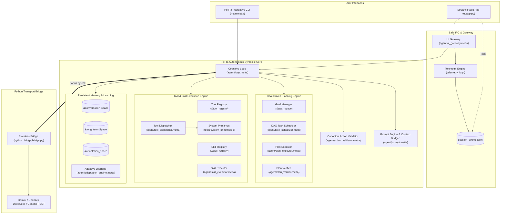

# Final Architecture Documentation: PeTTa Agentic AI Framework

## 1. System Overview & Purity of Agent Runtime

The **PeTTa Agentic AI Framework** couples symbolic artificial intelligence with neural Large Language Models.

Unlike typical Python-centric agent libraries, this architecture enforces a strict physical boundary:
- **PeTTa Symbolic Core:** Owns the cognitive loop, prompt generation, action grammar validation, tool registration & dispatch, DAG goal planning, memory management, and adaptive learning.
- **Python Transport Layer:** Stateless REST HTTP client invoking Gemini, OpenAI, DeepSeek, or local Ollama endpoints via SWI-Prolog's Janus bridge.
- **Presentation Layer:** Subprocess-isolated Streamlit application tailing unbuffered JSONL telemetry.

## 2. Mandatory Five Tools & Built-In System Primitives

1. **`read_file`:** Safe UTF-8 file reading with path existence check and 1 MB size bound.
2. **`write_file`:** Safe UTF-8 file writing with critical system path protection (`/etc`, `/usr`, `/bin`).
3. **`run_command`:** Bash shell execution via SWI-Prolog `process_create/3` with configurable timeout and destructive command blocking (`rm -rf`, `mkfs`, `dd`, `shutdown`) requiring `Approved=true`.
4. **`send_message`:** Direct status messaging to user.
5. **`ask_user`:** Canonical clarification action for interactive turn resolution.
6. **Additional Built-in Tools:** `calculator`, `word_counter`, `text_analyzer`, `string_reverser`, `datetime`.
