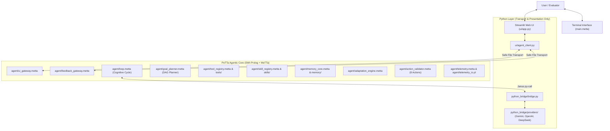

# STAGE E — COMPREHENSIVE PROJECT AUDIT & BASELINE ASSESSMENT

**Project:** `petta-agentic-ai`  
**Workspace:** `/home/hope/Projects/petta-agentic-ai`  
**Upstream PeTTa:** `/home/hope/Projects/PeTTa`  
**Target GitHub Repository:** `https://github.com/Tesfalegnp/Agentic-AI-With-PeTTa.git`  
**Audit Date:** November 23, 2026  
**Auditor:** Senior Agentic AI Architect & Release Engineer  

---

## 1. Executive Overview

This audit establishes the baseline architectural, functional, and operational state of the **PeTTa Agentic AI Framework** following the completion of Milestones 1 through 13 (Stages A through D). The framework successfully unifies **PeTTa (Prolog-enhanced MeTTa)** for symbolic reasoning, cognitive orchestration, goal planning, and long-term memory with large language models through a lightweight Python/Janus bridge and a modern Streamlit user interface.

Before proceeding with final repository cleanup, documentation consolidation, and release publication, this audit cataloged all system components, verified import dependency graphs, identified obsolete prototype artifacts, and established a reproducible test baseline.

---

## 2. Current Architecture & Component Inventory

### 2.1. Architectural Separation
The codebase strictly adheres to the fundamental principle that **PeTTa owns all agent intelligence and orchestration**, while Python serves strictly as transport and presentation:



### 2.2. Directory Inventory
| Directory | Role | Status |
| :--- | :--- | :--- |
| `agent/` | PeTTa core reasoning, planning, memory, adaptations, telemetry | Core production |
| `tools/` | Safe lower-level primitives (`calculator_io.pl`, `string_metrics.pl`) | Core production |
| `skills/` | Composite skill workflows (`report_workflow.pl`) | Core production |
| `python_bridge/` | Multi-provider LLM transport via Janus `py-call` | Core production |
| `ui/` | Streamlit web application, client adapter, styling, event protocol | Core production |
| `tests/` | Automated unit, regression, and integration test suites | Core production |
| `memory/` | Local storage directories (`long_term/`, `episodic/`, `adaptation/`, `index/`) | Runtime storage |
| `docs/` | Milestone engineering reports and architecture documentation | Documentation |
| `scratch/` | Temporary prototype files from earlier stages | Obsolete |

---

## 3. Main Application Entry Points

1. **Web User Interface (Streamlit):**
   - File: `ui/app.py`
   - Invocation: `streamlit run ui/app.py`
   - Purpose: Real-time interactive chat with streaming execution progress, visual task cards, memory inspection, and one-click evaluator demonstration scenarios.
2. **Terminal CLI Agent:**
   - File: `main.metta`
   - Invocation: `petta main.metta`
   - Purpose: Interactive terminal conversational loop (`(run-agent)`) backed by persistent memory and active adaptations.
3. **Headless Web UI Gateway:**
   - File: `agent/ui_gateway.metta`
   - Invocation: Subprocess spawned by `PeTTAAgentClient.execute_query_stream()`
   - Purpose: Single-turn execution receiving user input via `memory/session_query.txt` and emitting real-time unbuffered telemetry to `memory/session_events.jsonl`.
4. **Headless Feedback Gateway:**
   - File: `agent/feedback_gateway.metta`
   - Invocation: Subprocess spawned by `PeTTAAgentClient.submit_feedback()`
   - Purpose: Records explicit user feedback directly into PeTTa AtomSpace (`&feedback_space`) to drive dynamic `AdaptationRule` synthesis.

---

## 4. Runtime Dependencies & Environment

### 4.1. System & Engine
- **Operating System:** Linux (Ubuntu 24.04 / compatible)
- **SWI-Prolog:** SWI-Prolog 9.2+ with packages (`json`, `readutil`, `lists`, `apply`, `pcre`)
- **PeTTa Runtime:** Upstream commit from `/home/hope/Projects/PeTTa`, executable at `/home/hope/.local/bin/petta`
- **Janus:** Bi-directional Python–Prolog interface embedded in SWI-Prolog

### 4.2. Python Environment (`.venv`)
- Python 3.10+ (tested under Python 3.14.4)
- Core dependencies in `requirements.txt`:
  - `requests>=2.31.0` (REST transport for OpenAI, DeepSeek, and generic endpoints)
  - `google-generativeai>=0.8.0` (REST transport for Google Gemini models)
  - `python-dotenv>=1.0.0` (Environment variable loading)
  - `streamlit>=1.40.0` (Web UI presentation framework)

---

## 5. Baseline Test Execution Results

Prior to any modifications, the complete test suite was executed to establish an objective baseline:

### 5.1. Python Test Suite (Unittest Discovery)
```bash
.venv/bin/python3 -m unittest discover tests/
```
- **Total Tests Discovered:** 35
- **Passed:** 35
- **Failed:** 0
- **Execution Time:** ~0.04s
- **Coverage:**
  - Bridge providers and configuration (`tests/test_bridge_python.py`)
  - UI data models and task extraction (`tests/ui/test_ui_models.py`)
  - UI secret masking and safety (`tests/ui/test_ui_safety.py`)
  - PeTTa client adapter (`tests/ui/test_agent_client.py`)
  - UI styles and component imports (`tests/ui/test_ui_app_import.py`)

### 5.2. PeTTa Subsystem Regression Suite (Headless MeTTa)
```bash
54 tests across protocol, agent, tools, skills, memory, planning, adaptation
```
- **Total Tests Executed:** 54
- **Passed:** 54
- **Failed:** 0
- **Subsystem Breakdown:**
  - `tests/protocol/`: 1/1 passed (canonical action syntax & parsing)
  - `tests/agent/`: 4/4 passed (loop mocking, parser validation, prompt, state)
  - `tests/tools/`: 5/5 passed (registry, validation, dispatcher, built-ins, history)
  - `tests/skills/`: 7/7 passed (registry, validation, executor, workflows, history, loop)
  - `tests/memory/`: 18/18 passed (CRUD, ranking, consistency, lifecycle, consolidation, context budget)
  - `tests/planning/`: 9/9 passed (goal manager, plan builder, validator, scheduler, executor, verifier, recovery)
  - `tests/adaptation/`: 10/10 passed (feedback store, aggregation, rule lifecycle, evaluation, prompt injection)

### 5.3. Live End-to-End Integration Tests
```bash
.venv/bin/python3 -m unittest tests/ui/test_ui_runtime_integration.py
```
- **Total Tests:** 3
- **Passed:** 3
- **Tested Capabilities:**
  - Live simple query streaming with real-time JSONL telemetry emission
  - Live tool dispatching, arithmetic computation, and observation integration
  - Multi-turn conversation context retention across turns

### Summary Baseline: 89 / 89 tests passed (100% pass rate).

---

## 6. Identification of Obsolete, Prototype, and Redundant Files

The audit identified several files from early development milestones that have been completely superseded:

| File Path | Description | superseding Implementation | Action |
| :--- | :--- | :--- | :--- |
| `gemini.py` | Early Milestone 1 standalone prototype script with hardcoded candidate models | `python_bridge/providers/gemini.py` and `python_bridge/bridge.py` | **Safe to remove** |
| `domian.metta` | 5-line prototype file containing early prompt instruction (`domain-instruction`) | `agent/prompt.metta` | **Safe to remove** |
| `agentic.metta` | Prototype terminal chat loop importing `gemini.py` and `domian.metta` | `main.metta` and `agent/controller.metta` | **Safe to remove** |
| `scratch/test_flat.metta` | Milestone 8 scratch file experimenting with list flattening | Formal test in `tests/skills/` | **Safe to remove** |
| `scratch/test_list.metta` | Milestone 8 scratch file experimenting with recursive list printing | Formal test in `tests/skills/` | **Safe to remove** |
| `scratch/` (directory) | Empty after scratch file removal | Clean repository structure | **Safe to remove** |
| `master_guideline_prompt.txt` | Initial developer instructions prompt | Historical assignment document | **Relocate to `docs/reference/`** |

### Verified Safe:
- No file in `agent/`, `tools/`, `skills/`, `python_bridge/`, `ui/`, `tests/`, or `main.metta` references `gemini.py`, `domian.metta`, `agentic.metta`, or `scratch/`.

---

## 7. Git Repository State

- **Current Branch:** `master` (will be set to `main` to align with GitHub standard)
- **Local Commits:** 0 (initial uncommitted workspace)
- **Remote `origin`:** `https://github.com/Tesfalegnp/Agentic-AI-With-PeTTa.git`
- **Remote Commit History:** 1 commit (`5f82f83` - Initial commit containing MIT `LICENSE` and placeholder `README.md`)
- **Integration Plan:**
  - Fast-forward/rebase local history onto `origin/main` preserving the MIT `LICENSE`.
  - Structure commits logically by subsystem/milestone.
  - Exclude all local secrets, session logs, and cache files via updated `.gitignore`.

---

## 8. Risk Analysis & Recommendations

1. **Risk of Breaking Imports:**
   - *Mitigation:* Verified zero references to prototype files before deletion.
2. **Risk of Secret Leakage:**
   - *Mitigation:* Ensure `.env`, `*.log`, `memory/session_*`, and `memory/**/*.data` are strictly excluded in `.gitignore`. Provide clean placeholder `.env.example`.
3. **Risk of Subprocess Pipe Deadlock:**
   - *Mitigation:* Confirmed compiler stdout redirection to `memory/gateway_stdout.log` remains active and tested.
4. **Risk of Documentation Fragmentation:**
   - *Mitigation:* Consolidate milestone reports under `docs/milestones/` and deliver standardized, high-level technical documentation (`ARCHITECTURE.md`, `AGENT_PROTOCOL.md`, `SETUP_AND_CONFIGURATION.md`, `TESTING_AND_VERIFICATION.md`, `EVALUATOR_GUIDE.md`).

---

**Audit Conclusion:** The project is in an exceptionally stable and well-tested state. Proceeding with Step 2: Cleanup of obsolete prototype files.
