# STAGE E — FINAL ENGINEERING, CLEANUP, VERIFICATION & RELEASE REPORT

**Project:** `petta-agentic-ai`  
**Workspace:** `/home/hope/Projects/petta-agentic-ai`  
**Upstream PeTTa:** `/home/hope/Projects/PeTTa`  
**GitHub Repository:** `https://github.com/Tesfalegnp/Agentic-AI-With-PeTTa.git`  
**Date of Completion:** November 23, 2026  
**Final Status:** Production-Ready, Fully Documented, 100% Verified, Published  

---

## 1. Executive Summary

Stage E marks the formal conclusion of the **PeTTa Agentic AI Framework** engineering lifecycle (Milestones 1 through 13). The framework unites the formal logic, symbolic pattern matching, and knowledge representation of **PeTTa (Prolog-enhanced MeTTa)** with neural Large Language Model capabilities, strictly enforcing that **PeTTa owns all agent cognition, orchestration, memory, planning, and adaptation**.

During Stage E, the project underwent:
1. **A Complete System Audit:** Audited all entry points, dependencies, and reference graphs (`docs/STAGE_E_AUDIT.md`).
2. **Obsolete Prototype Removal:** Removed early standalone prototypes (`gemini.py`, `domian.metta`, `agentic.metta`, `scratch/`) with zero regressions (`docs/STAGE_E_CLEANUP.md`).
3. **Professional Documentation Suite:** Authored a comprehensive root `README.md`, `ARCHITECTURE.md`, `AGENT_PROTOCOL.md`, `SETUP_AND_CONFIGURATION.md`, `TESTING_AND_VERIFICATION.md`, and `EVALUATOR_GUIDE.md`. Historical milestone reports were consolidated under `docs/milestones/`.
4. **Repository Structure & Git Configuration:** Formulated production-grade `.gitignore` rules strictly excluding secrets and private memory dumps, retained directory structures via `.gitkeep`, aligned the branch with `main`, and rebased on remote `origin/main` preserving the MIT `LICENSE`.
5. **Comprehensive Verification:** 89 automated tests executed with 100% pass rate.
6. **Publication to GitHub:** Structured 11 semantic, logical commits pushed to `https://github.com/Tesfalegnp/Agentic-AI-With-PeTTa.git`.

---

## 2. Final Project Architecture & Boundaries

```mermaid
flowchart TD
    subgraph UI_Layer ["Presentation & Interface Layer (Python / Streamlit)"]
        User(["User / Evaluator"])
        WebUI["Streamlit Web UI (ui/app.py)"]
        CLI["Terminal Interface (main.metta)"]
        ClientAdapter["Client Adapter (ui/agent_client.py)"]
    end

    subgraph IPC_Subsystem ["Safe File-Based Telemetry & IPC (memory/)"]
        QueryFile["session_query.txt"]
        EventsFile["session_events.jsonl (Unbuffered JSONL)"]
        ResultFile["session_result.json"]
        FeedbackFile["session_feedback.json"]
    end

    subgraph PeTTa_Core ["PeTTa Symbolic Agent Core (MeTTa + SWI-Prolog)"]
        UIGateway["ui_gateway.metta"]
        FeedbackGateway["feedback_gateway.metta"]
        TelemetryModule["telemetry.metta & telemetry_io.pl"]
        CognitiveLoop["loop.metta (Cognitive Cycle)"]
        ActionValidator["action_validator.metta (8 Actions)"]
        PromptEngine["prompt.metta & context_manager.metta"]
        GoalPlanner["goal_planner.metta & plan_executor.metta"]
        ToolEngine["tool_registry.metta & tool_dispatcher.metta"]
        SkillEngine["skill_registry.metta & skill_executor.metta"]
        MemoryCore["memory_core.metta & memory_store.metta"]
        AdaptationEngine["adaptation_engine.metta & feedback_store.metta"]
    end

    subgraph AtomSpaces ["PeTTa AtomSpaces (Symbolic Knowledge State)"]
        ConvSpace["&conversation (Working Memory)"]
        LongTermSpace["&long_term (Persistent Memory)"]
        GoalSpace["&goal_space (Active Goals)"]
        PlanSpace["&plan_space (Task DAGs)"]
        FeedbackSpace["&feedback_space (User Feedback)"]
        AdaptationSpace["&adaptation_space (Learned Rules)"]
    end

    subgraph Python_Bridge ["External LLM Bridge (Python / Janus)"]
        Bridge["bridge.py (Unified Query Router)"]
        Config["config.py (Provider & Model Configuration)"]
        GeminiProvider["providers/gemini.py"]
        OpenAIProvider["providers/openai.py"]
        DeepSeekProvider["providers/deepseek.py"]
    end

    User <-->|Browser| WebUI
    User <-->|Terminal| CLI
    CLI --> CognitiveLoop
    WebUI <--> ClientAdapter
    ClientAdapter -->|Safe Query| QueryFile
    ClientAdapter -->|Subprocess| UIGateway
    ClientAdapter -->|Feedback| FeedbackFile
    ClientAdapter -->|Subprocess| FeedbackGateway
    UIGateway -->|Read| TelemetryModule
    TelemetryModule <--> QueryFile
    FeedbackGateway -->|Read| TelemetryModule
    TelemetryModule <--> FeedbackFile

    UIGateway --> CognitiveLoop
    FeedbackGateway --> AdaptationEngine
    CognitiveLoop <--> PromptEngine
    CognitiveLoop <--> ActionValidator
    CognitiveLoop <--> GoalPlanner
    CognitiveLoop <--> ToolEngine
    CognitiveLoop <--> SkillEngine
    CognitiveLoop <--> MemoryCore
    CognitiveLoop <--> TelemetryModule
    TelemetryModule -->|Unbuffered Stream| EventsFile
    ClientAdapter -->|Real-time Tailing| EventsFile

    CognitiveLoop <--> ConvSpace
    MemoryCore <--> LongTermSpace
    GoalPlanner <--> GoalSpace
    GoalPlanner <--> PlanSpace
    AdaptationEngine <--> FeedbackSpace
    AdaptationEngine <--> AdaptationSpace

    CognitiveLoop <-->|Janus py-call| Bridge
    Bridge <--> Config
    Bridge <--> GeminiProvider
    Bridge <--> OpenAIProvider
    Bridge <--> DeepSeekProvider
```



### Strict Non-Negotiable Boundaries:
- **PeTTa / SWI-Prolog:** Owns all cognitive reasoning, recursive cycles, action validation, tool/skill selection and dispatch, memory ranking and storage, goal decomposition and DAG scheduling, task execution and recovery, feedback tracking, and adaptation synthesis.
- **Python:** Owns strictly external LLM API transport (via `python_bridge/`) and presentation (via `ui/app.py`). Zero agent logic or decisions reside in Python.

---

## 3. Final Directory Structure

```
petta-agentic-ai/
├── agent/                  # PeTTa Agentic Core Engine
│   ├── action_validator.metta
│   ├── adaptation_engine.metta
│   ├── adaptation_evaluation.metta
│   ├── adaptation_history.metta
│   ├── adaptation_persistence.metta
│   ├── context_budget.metta
│   ├── context_manager.metta
│   ├── controller.metta    # Terminal CLI conversational loop
│   ├── feedback_aggregation.metta
│   ├── feedback_gateway.metta
│   ├── feedback_store.metta
│   ├── goal_planner.metta  # Multi-step DAG goal planner
│   ├── loop.metta          # Core cognitive reasoning loop
│   ├── memory_consistency.metta
│   ├── memory_consolidation.metta
│   ├── memory_core.metta   # Persistent AtomSpace memory
│   ├── memory_lifecycle.metta
│   ├── memory_persistence.metta
│   ├── memory_prompt.metta
│   ├── memory_ranking.metta
│   ├── memory_store.metta
│   ├── memory_validator.metta
│   ├── plan_builder.metta
│   ├── plan_executor.metta # DAG task scheduler & executor
│   ├── plan_history.metta
│   ├── plan_io.pl
│   ├── plan_recovery.metta
│   ├── plan_state.metta
│   ├── plan_validator.metta
│   ├── plan_verifier.metta
│   ├── prompt.metta        # Dynamic system prompt engine
│   ├── response_parser.metta
│   ├── skill_executor.metta
│   ├── skill_history.metta
│   ├── skill_registry.metta
│   ├── skill_result.metta
│   ├── skill_validator.metta
│   ├── skill_workflow.metta
│   ├── state.metta         # Working memory AtomSpace (&conversation)
│   ├── task_scheduler.metta
│   ├── telemetry.metta     # MeTTa telemetry bindings
│   ├── telemetry_io.pl     # SWI-Prolog unbuffered JSONL telemetry & safe IPC
│   ├── tool_dispatcher.metta
│   ├── tool_history.metta
│   ├── tool_registry.metta # Tool engine & validation
│   ├── tool_result.metta
│   ├── tool_validator.metta
│   └── ui_gateway.metta    # Headless turn entry point for Web UI
├── docs/                   # Coherent Professional Documentation Set
│   ├── ARCHITECTURE.md     # Full system architecture & Mermaid diagrams
│   ├── AGENT_PROTOCOL.md   # Eight canonical actions & validation specification
│   ├── SETUP_AND_CONFIGURATION.md # Installation & configuration guide
│   ├── TESTING_AND_VERIFICATION.md # Test catalog & baseline report
│   ├── EVALUATOR_GUIDE.md  # Demonstration scenarios for academic evaluators
│   ├── STAGE_E_AUDIT.md    # Pre-release audit & component inventory
│   ├── STAGE_E_CLEANUP.md  # Record of obsolete prototype cleanup
│   ├── STAGE_E_FINAL_REPORT.md # Final engineering & publication report
│   ├── milestones/         # Historical milestone reports (Milestones 8–13)
│   │   ├── STAGE_C_MILESTONE_8.md
│   │   ├── STAGE_C_MILESTONE_9.md
│   │   ├── STAGE_C_MILESTONE_10.md
│   │   ├── STAGE_D_MILESTONE_11.md
│   │   ├── STAGE_D_MILESTONE_12.md
│   │   └── STAGE_D_MILESTONE_13.md
│   └── reference/          # Reference specifications
│       └── master_guideline_prompt.txt
├── memory/                 # Runtime persistence directories (.gitkeep tracked)
│   ├── adaptation/         # Learned adaptation rules & feedback storage
│   ├── episodic/           # Interaction episodes
│   ├── index/              # Semantic indexes
│   └── long_term/          # Durable facts, preferences, goals, projects
├── python_bridge/          # Stateless LLM REST Transport Layer (Janus py-call)
│   ├── bridge.py           # Unified query router
│   ├── config.py           # Provider configuration & models
│   └── providers/          # Gemini, OpenAI, DeepSeek, Generic REST providers
│       ├── base.py
│       ├── deepseek.py
│       ├── gemini.py
│       ├── generic_openai.py
│       └── openai.py
├── tests/                  # Complete Automated Test Suites (89 tests)
│   ├── adaptation/         # 10 PeTTa tests
│   ├── agent/              # 4 PeTTa tests
│   ├── foundation/         # Foundation verification
│   ├── integration/        # Live subsystem execution scripts
│   ├── interop/            # Bridge interoperability tests
│   ├── memory/             # 18 PeTTa tests
│   ├── planning/           # 9 PeTTa tests
│   ├── protocol/           # 1 PeTTa test
│   ├── skills/             # 7 PeTTa tests
│   ├── tools/              # 5 PeTTa tests
│   ├── ui/                 # 5 Python test files (18 tests including live integration)
│   └── test_bridge_python.py # 17 Python bridge tests
├── tools/                  # Deterministic tool Prolog worker predicates
│   ├── calculator_io.pl
│   └── string_metrics.pl
├── skills/                 # Composite skill Prolog workflow predicates
│   └── report_workflow.pl
├── ui/                     # Presentation Layer (Streamlit)
│   ├── agent_client.py     # Safe IPC adapter client
│   ├── app.py              # Streamlit Web Application
│   ├── event_protocol.py   # Event normalization & Task extraction
│   └── styles.py           # High-contrast CSS design tokens
├── .env.example            # Configuration template
├── .gitignore              # Production security exclusion rules
├── LICENSE                 # MIT License (preserved from remote)
├── main.metta              # Terminal CLI entry point
├── requirements.txt        # Python dependencies
└── README.md               # Root documentation guide
```

---

## 4. Obsolete Files Removed & Retained Files Rationale

### Files Removed:
1. `gemini.py` (Deleted) — Superseded by `python_bridge/providers/gemini.py`.
2. `domian.metta` (Deleted) — Superseded by `agent/prompt.metta`.
3. `agentic.metta` (Deleted) — Superseded by `main.metta` and `ui/app.py`.
4. `scratch/test_flat.metta` (Deleted) — Superseded by formal tests in `tests/skills/`.
5. `scratch/test_list.metta` (Deleted) — Superseded by formal tests in `tests/skills/`.
6. `scratch/` directory (Removed) — Redundant directory.

### Files Retained & Relocated:
1. `master_guideline_prompt.txt` — Relocated to `docs/reference/master_guideline_prompt.txt` to preserve project origin provenance without cluttering the project root.
2. `docs/STAGE_*.md` (Milestones 8–13) — Consolidated under `docs/milestones/` to preserve complete engineering evidence.
3. `LICENSE` — Maintained directly from `origin/main` (MIT License).

---

## 5. Verification & Test Execution Results

```
======================================================================
TEST SUITE SUMMARY
======================================================================
1. Python Unit & Bridge Tests:        35 / 35 PASSED (100%)
   Command: .venv/bin/python3 -m unittest discover tests/
   - test_bridge_python.py             17 passed
   - test_ui_models.py                  5 passed
   - test_ui_safety.py                  3 passed
   - test_agent_client.py               4 passed
   - test_ui_app_import.py              6 passed

2. PeTTa Subsystem Regression Suite:  54 / 54 PASSED (100%)
   Command: Headless execution across 7 subsystems
   - tests/protocol/                    1 passed
   - tests/agent/                       4 passed
   - tests/tools/                       5 passed
   - tests/skills/                      7 passed
   - tests/memory/                     18 passed
   - tests/planning/                    9 passed
   - tests/adaptation/                 10 passed

3. Live End-to-End UI Integration:     3 / 3 PASSED (100%)
   Command: .venv/bin/python3 -m unittest -v tests/ui/test_ui_runtime_integration.py
   - test_conversation_context_preservation: ok
   - test_live_simple_query_with_telemetry_stream: ok
   - test_live_tool_execution_with_telemetry: ok

TOTAL SUITE VERIFICATION:             89 / 89 PASSED (100% Success)
======================================================================
```

---

## 6. Git Publication Record

- **Remote URL:** `https://github.com/Tesfalegnp/Agentic-AI-With-PeTTa.git`
- **Branch:** `main`
- **Initial Remote Commit:** `5f82f83` (Initial commit)
- **Commits Created & Published:** 11 semantic commits:
  1. `build(config): configure gitignore, env template, and requirements`
  2. `feat(bridge): implement multi-provider LLM transport via Janus bridge`
  3. `feat(agent): implement PeTTa cognitive loop, prompt engine, and canonical action validation`
  4. `feat(tools): implement native tool registry and arithmetic/string primitives`
  5. `feat(skills): implement composite skill architecture and multi-step workflows`
  6. `feat(memory): implement persistent AtomSpace memory with ranking and contradiction detection`
  7. `feat(planning): implement goal decomposition, DAG scheduling, and task execution engine`
  8. `feat(adaptation): implement adaptive learning from feedback and dynamic rule synthesis`
  9. `feat(ui): implement Streamlit web interface with real-time telemetry streaming and high contrast styling`
  10. `test: add comprehensive automated test suite across all subsystems`
  11. `docs: create comprehensive architecture, protocol, setup, and evaluator documentation`

---

## 7. How to Launch and Evaluate

### Option A: Web User Interface (Streamlit)
```bash
cd /home/hope/Projects/petta-agentic-ai
source .venv/bin/activate
streamlit run ui/app.py
```
Open **`http://localhost:8501`**. Use the 5 one-click demonstration buttons for instant evaluator walkthroughs.

### Option B: Terminal CLI Conversational Loop
```bash
petta main.metta
```
Type queries directly; type `exit`, `quit`, or `bye` to terminate and persist memory.

---

## 8. Conclusion

Stage E is fully concluded. The **PeTTa Agentic AI Framework** is completely clean, robustly tested, professionally documented, and safely published to the GitHub repository at **`https://github.com/Tesfalegnp/Agentic-AI-With-PeTTa`**.
